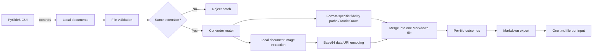

<div align="center">


# 📄 Hybrid Document to Markdown

### A local-first Windows desktop converter powered by Python and Microsoft MarkItDown

[](#-roadmap)
[](#-testing)
[](#-technology-stack)

[](https://github.com/microsoft/markitdown)
[](https://doc.qt.io/qtforpython-6/)
[](#requirements)
[](LICENSE)

**Convert common documents into readable Markdown without rebuilding format-specific parsers from scratch.**<br>
**The project combines a tested conversion core with a beginner-friendly Windows desktop workflow.**

[Overview](#-overview) •
[Features](#-feature-status) •
[Formats](#-supported-formats) •
[Quick Start](#-quick-start) •
[Architecture](#-architecture) •
[Roadmap](#-roadmap)

</div>

---

> [!IMPORTANT]
> **Q3 is complete for the documented format policies and acceptance fixtures: 134 tests pass.** See [Q3 acceptance and limits](docs/Q3_ACCEPTANCE.md), the [implementation report](docs/QUALITY_IMPLEMENTATION.md), and [changelog](CHANGELOG.md). Q4 contextual assets and Q5 broader evaluation remain WIP. Base64 remains the default.

> [!NOTE]
> This is an independent portfolio project that uses [Microsoft MarkItDown](https://github.com/microsoft/markitdown). It is not an official Microsoft product and is not affiliated with or endorsed by Microsoft.

## 📚 Table of Contents

- [Overview](#-overview)
- [Feature Status](#-feature-status)
- [Supported Formats](#-supported-formats)
- [How Conversion Works](#-how-conversion-works)
- [Quick Start](#-quick-start)
  - [Requirements](#requirements)
  - [Installation](#installation)
  - [Run the Desktop App](#-run-the-desktop-app)
  - [Run the Tests](#run-the-tests)
  - [Use the Core API](#-use-the-core-api)
- [Batch Rules and Validation](#-batch-rules-and-validation)
- [Architecture](#-architecture)
- [Project Structure](#-project-structure)
- [Testing](#-testing)
- [Privacy and Limitations](#-privacy-and-limitations)
- [Technology Stack](#-technology-stack)
- [Roadmap](#-roadmap)
- [Engineering Principles](#-engineering-principles)
- [License and Credits](#-license-and-credits)

<a id="-overview"></a>

## 🔎 Overview

<table>
<tr>
<td width="50%" valign="top">
<h3>🎯 What it does</h3>
<p>Hybrid Document to Markdown converts common documents into Markdown (<code>.md</code>). It targets users who want a clear Windows workflow instead of manual conversion commands.</p>
<ul>
<li>Validates local documents</li>
<li>Routes multiple file formats</li>
<li>Processes safe same-extension batches</li>
<li>Preserves independent file outcomes</li>
<li>Exports UTF-8 Markdown</li>
</ul>
</td>
<td width="50%" valign="top">
<h3>💡 Why it exists</h3>
<p>The project combines established document parsers with focused fidelity paths for text and structured data, supported by a local desktop workflow and regression tests.</p>
<ul>
<li>Local-first processing</li>
<li>Predictable validation</li>
<li>Transparent errors</li>
<li>PySide6 desktop usability</li>
<li>Reproducible integration tests</li>
</ul>
</td>
</tr>
</table>

> [!NOTE]
> Earlier heuristic TXT-converter code remains as a learning milestone. Production combines dedicated fidelity paths, Mammoth for Word, pdfplumber for PDF layout, and MarkItDown for PowerPoint text/chart conversion.

<a id="-feature-status"></a>

## ✨ Feature Status

<table>
<tr>
<td width="50%" valign="top">
<h3>✅ Implemented</h3>
<ul>
<li>Multi-format conversion core</li>
<li>Same-extension batch conversion</li>
<li>Independent per-file outcomes</li>
<li>Existence, type, extension, size, and readability validation</li>
<li>UTF-8 Markdown export with overwrite protection</li>
<li>Accessible file picker and drag and drop</li>
<li>Threaded conversion with per-file status</li>
<li>Markdown preview, copy, and collision-safe export</li>
<li>Low-glare dark-medieval pixel theme with a TXT-first file selector</li>
<li>Custom transparent pixel-art application and header logo</li>
<li>Scrollbars that appear only when content overflows</li>
<li>Progressive “Save Markdown” action shown after successful conversion</li>
<li>Automatic DOCX, PPTX, and XLSX embedded-image extraction</li>
<li>Automatic local PDF-page rendering</li>
<li>PNG, JPEG, GIF, WebP, BMP, TIFF, and SVG data-URI support</li>
<li>Single-file Markdown output with Base64-embedded images</li>
<li>No OCR runtime, model pack, dataset, or training requirement</li>
<li>Real DOCX image-to-Base64 integration coverage</li>
<li>134 passing automated tests, including Q3 source-backed complex-format acceptance</li>
</ul>
</td>
<td width="50%" valign="top">
<h3>🚧 WIP &amp; planned</h3>
<ul>
<li><strong>Completed — Phase E:</strong> preserve images inside one Markdown file</li>
<li><strong>Implemented — Quality Q2:</strong> options, warnings, atomic export and resource safeguards</li>
<li><strong>Completed — Quality Q3:</strong> format fidelity policies and acceptance fixtures</li>
<li><strong>WIP — Quality Q4–Q5:</strong> contextual assets and broader evaluation</li>
<li><strong>Planned — Phase F:</strong> Windows packaging after quality hardening</li>
<li><strong>Planned:</strong> compatibility testing with major multimodal AI clients</li>
</ul>
</td>
</tr>
</table>

<a id="-supported-formats"></a>

## 🗃️ Supported Formats

Representative integration coverage exists for every MVP format.

| Category | Extensions | Dependency path | Verification |
|---|---|---|:---:|
| Plain text | `.txt` | Strict decoded source preservation | ✅ Passed |
| Word | `.docx` | Mammoth + protected semantic HTML | ✅ Tables, nested lists and notes |
| PDF | `.pdf` | pdfplumber page geometry | ✅ Explicit columns and ruled tables |
| PowerPoint | `.pptx` | `markitdown[pptx]` | ✅ Passed |
| Excel | `.xlsx` | openpyxl + source XML literals | ✅ Values, formulas and metadata |
| Tabular data | `.csv` | String fields + original source appendix | ✅ Passed |
| Web documents | `.html`, `.htm` | Local HTML adapter + MarkItDown HTML parser | ✅ Passed |
| Structured text | `.json`, `.xml` | Source-preserving fenced text | ✅ Passed |

> [!WARNING]
> “Supported” does not mean perfect visual fidelity. Embedded images are preserved as Base64, not interpreted. Whether an AI chat decodes a Markdown data URI depends on that platform.

Emails, archives, audio, EPUB, LOG files, and standalone image conversion are outside the committed MVP scope.

<a id="-how-conversion-works"></a>

## 🔄 How Conversion Works



The conversion path is local. TXT/JSON/XML/CSV/XLSX use dedicated fidelity paths; HTML/HTM preserve preformatted text and complex tables. Word uses Mammoth with protected table/note structures; PDF uses pdfplumber page geometry; PowerPoint combines MarkItDown with source-backed chart/connector metadata. `DocumentImageExtractor` retrieves visuals and the media decorator embeds Base64. Limits reject oversized processing explicitly.

<a id="-quick-start"></a>

## 🚀 Quick Start

<table>
<tr>
<td width="38%" valign="top">
<h3 id="requirements">📋 Requirements</h3>
<ul>
<li>Windows 10 or 11</li>
<li>Python 3.13</li>
<li>Git and PowerShell</li>
<li>Internet during installation</li>
</ul>
<p>No API key is required for local conversion.</p>
<h3 id="run-the-tests">🧪 Test</h3>
<pre><code>python -m pytest -q</code></pre>
<p>Last verified: <code>134 passed</code> (2026-11-11)</p>
</td>
<td width="62%" valign="top">
<h3 id="installation">📦 Installation</h3>
<pre><code>git clone https://github.com/DrBham/Hybird-Document-To-Markdown.git
cd Hybird-Document-To-Markdown

python -m venv .venv
.\.venv\Scripts\Activate.ps1

python -m pip install -r requirements.txt
python -m pip check</code></pre>
<p>Activate <code>.venv</code> before developing or testing so project packages stay isolated.</p>
</td>
</tr>
</table>

> [!NOTE]
> The root-level `pytest.ini` adds `src` to pytest's import path. It is configuration, not a generated cache file.

<a id="-run-the-desktop-app"></a>

### 🖥️ Run the Desktop App

From the repository root with the virtual environment active:

```powershell
$env:PYTHONPATH = "src"
python -m document_converter
```

The file-type selector starts at TXT. Choose another format when needed, then browse or drag matching documents, convert them, review a result, and choose an output folder. “Save Markdown” appears after at least one conversion succeeds. Conversion runs in a worker thread, so the window remains responsive.

### 🖼️ Single-File Image Embedding

Image embedding is automatic for PDF, DOCX, PPTX, and XLSX inputs. No separate runtime or model installation is required.

The generated Markdown contains entries such as:

```markdown

```

The characters after `base64,` encode the extracted image bytes. Supported OOXML media are copied without recompression; PDF images in this workflow are newly rendered page PNGs, not the original embedded image bytes. Decoding or displaying these payloads depends on the receiving client; uploading a `.md` file does not guarantee that an AI chat will inspect its images.

> [!IMPORTANT]
> Base64 is encoding, not encryption or OCR. It preserves the original visual but does not describe its meaning. Uploading the Markdown to a third-party AI also subjects its contents to that provider's privacy policy.

> [!WARNING]
> Base64 increases binary size by roughly one third, and not every AI chat accepts or renders data URIs from an uploaded `.md` file. Large PDFs can therefore produce very large Markdown files.

<a id="-use-the-core-api"></a>

### 🧑‍💻 Use the Core API

See [advanced options and asset ZIP export](docs/QUALITY_IMPLEMENTATION.md#api-and-compatibility) for encoding, delimiter, PDF mode, formula/cache view, sheet selection, resource budgets, and portable assets. These advanced options are available through the core API; the GUI keeps its Base64 workflow.

> [!NOTE]
> The desktop app is the recommended interactive workflow. The examples below show how to reuse the tested Python core directly.

Convert one file:

```python
from pathlib import Path

from document_converter.core.router import ConverterRouter
from document_converter.services.markdown_exporter import MarkdownExporter


source = Path("documents/report.pdf")

conversion = ConverterRouter().convert(source)
output = source.with_suffix(".md")

MarkdownExporter().export(
    conversion.markdown,
    output,
    overwrite=False,
)

print(f"Saved: {output}")
```

Convert a same-extension batch:

```python
from pathlib import Path

from document_converter.services.batch_converter import BatchConverter


files = [
    Path("documents/report.pdf"),
    Path("documents/manual.pdf"),
    Path("documents/tutorial.PDF"),
]

batch = BatchConverter().convert(files)

for outcome in batch.outcomes:
    if outcome.succeeded:
        print(f"Converted: {outcome.source_path.name}")
    else:
        print(f"Failed: {outcome.source_path.name} — {outcome.error}")
```

When running a standalone development script from the repository root, expose the `src` directory first:

```powershell
$env:PYTHONPATH = "src"
python .\your_script.py
```

<a id="-batch-rules-and-validation"></a>

## 🛡️ Batch Rules and Validation

<table>
<tr>
<td width="50%" valign="top">
<h3>📚 Batch rules</h3>
<ul>
<li>At least one file is required.</li>
<li>All extensions must match, ignoring case.</li>
<li>Each file converts independently.</li>
<li>Successful results survive other failures.</li>
<li>Files are never merged automatically.</li>
</ul>
<p><strong>Allowed:</strong> <code>report.pdf</code>, <code>manual.PDF</code></p>
<p><strong>Rejected:</strong> <code>report.pdf</code>, <code>slides.pptx</code></p>
</td>
<td width="50%" valign="top">
<h3>🛡️ File validation</h3>
<ul>
<li>The path exists.</li>
<li>The path points to a file.</li>
<li>The extension is on the MVP allowlist.</li>
<li>The file is no larger than 100 MiB.</li>
<li>The file can be opened for reading.</li>
</ul>
<p>Validation happens before MarkItDown receives the document.</p>
</td>
</tr>
</table>

<a id="-architecture"></a>

## 🏗️ Architecture

| Layer | Responsibility | Main components |
|---|---|---|
| Core models | Stable application-level results | `ConversionResult`, `FileConversionOutcome`, `BatchConversionResult` |
| Validation | Reject invalid input early | `validate_file()` |
| Routing | Select the converter by extension | `ConverterRouter` |
| Conversion adapter | Isolate the third-party engine | `MarkItDownConverter` |
| Services | Coordinate batches and export | `BatchConverter`, `MarkdownExporter` |
| Image extraction | Extract OOXML media and render PDF pages locally | `DocumentImageExtractor` |
| Media embedding | Encode images as Base64 data URIs and append them to Markdown | `EmbeddedMediaDocumentConverter` |
| GUI | Desktop interaction | PySide6 window, worker thread, preview, and export workflow |

### Why an adapter?

`MarkItDownConverter` keeps third-party details behind the project's `BaseConverter` interface. The rest of the application works with its own models instead of depending directly on MarkItDown internals.

This design provides:

- Easier unit testing with fake engines
- Clear ownership boundaries
- Lower migration cost if the engine API changes
- Reusable core logic for the desktop GUI and future integrations

<a id="-project-structure"></a>

## 🗂️ Project Structure

```text
.
├── src/
│   └── document_converter/
│       ├── __main__.py
│       ├── converters/
│       │   ├── markitdown_converter.py
│       │   └── txt_converter.py
│       ├── core/
│       │   ├── base_converter.py
│       │   ├── models.py
│       │   ├── router.py
│       │   └── validator.py
│       ├── gui/
│       │   ├── app.py
│       │   ├── main_window.py
│       │   └── theme.py
│       ├── embedded_media/
│       │   ├── converter.py
│       │   └── extractor.py
│       └── services/
│           ├── batch_converter.py
│           └── markdown_exporter.py
├── design-system/
│   └── hybrid-document-to-markdown/
│       └── MASTER.md
├── assets/
│   ├── branding/
│   │   └── app-logo.png
│   └── fonts/
│       ├── PressStart2P-Regular.ttf
│       ├── PressStart2P-OFL.txt
│       └── PressStart2P-FONTLOG.txt
├── tests/
├── tools/audit_conversion_quality.py
├── docs/CONVERSION_QUALITY_AUDIT.md
├── CHANGELOG.md
├── pytest.ini
├── requirements.in
├── requirements.txt
├── THIRD_PARTY_NOTICES.md
└── README.md
```

<a id="-testing"></a>

## 🧪 Testing

The test suite focuses on application behavior and third-party integration boundaries. It does not pretend to test MarkItDown's internal algorithms as original project code.

Q1 baseline: **80 → 92 passed**. Current suite: **134 passed**, including fifteen Q3 acceptance cases for PDF columns/merged tables, Word nested lists/tables/footnotes, chart/connector metadata, exact XLSX numeric literals, and nested HTML code. Passing these fixtures does not establish fidelity for every possible layout. See [Q3 acceptance](docs/Q3_ACCEPTANCE.md).

Run reproducible synthetic probes with `python tools/audit_conversion_quality.py`. The script prints source/output comparisons and removes its temporary fixtures; it is not an accuracy benchmark. See the [audit](docs/CONVERSION_QUALITY_AUDIT.md) for observed losses and the measurement plan.

Run `python tools/evaluate_quality.py` for isolated ten-format checks, conversion time and process peak memory. The [implementation report](docs/QUALITY_IMPLEMENTATION.md) records measured results and pending acceptance work.

<table>
<tr>
<td width="50%" valign="top">
<h3>🔌 Integration coverage</h3>
<ul>
<li>All agreed MVP extensions</li>
<li>Real TXT, DOCX, and text-based PDF conversion</li>
<li>Real PPTX and XLSX conversion</li>
<li>Real CSV, HTML/HTM, JSON, and XML conversion</li>
</ul>
</td>
<td width="50%" valign="top">
<h3>⚙️ Behavior coverage</h3>
<ul>
<li>Invalid, oversized, and unreadable files</li>
<li>Case-insensitive and mixed-extension batches</li>
<li>Partial failures and result preservation</li>
<li>Unicode export and overwrite protection</li>
<li>GUI selection, state, threaded conversion, and export workflow</li>
<li>OOXML media extraction for DOCX, PPTX, and XLSX</li>
<li>PDF-page rendering and Base64 data-URI generation</li>
<li>Real DOCX image embedding through the default router</li>
</ul>
</td>
</tr>
</table>

Run the full suite with:

```powershell
python -m pytest -q
```

> [!NOTE]
> A local passing test badge is shown at the top because this repository does not yet have a GitHub Actions workflow. A live CI badge should replace it after CI is configured.

<a id="-privacy-and-limitations"></a>

## 🔐 Privacy and Limitations

<table>
<tr>
<td width="50%" valign="top">
<h3>🔒 Local-first privacy</h3>
<ul>
<li>Conversion and image embedding need no API key.</li>
<li>Documents are not uploaded by the application.</li>
<li>The application does not configure or use an OCR model, training dataset, or inference runtime.</li>
<li>Images are encoded locally and remain inside the exported Markdown.</li>
<li>Users choose whether to upload the result to a third-party AI.</li>
</ul>
</td>
<td width="50%" valign="top">
<h3>⚠️ Current limitations</h3>
<ul>
<li>A packaged <code>.exe</code> is not available yet.</li>
<li>Not every Markdown renderer or AI chat supports Base64 data URIs.</li>
<li>Base64 output is larger than the original binary image data.</li>
<li>The application preserves images but does not interpret diagrams or run OCR.</li>
<li>Complex layouts may lose fidelity.</li>
<li>XLSX preserves string identifiers and formulas; numeric values already rounded in Excel cannot be recovered. Formula caches can be absent or stale.</li>
<li>TXT uses strict explicit decoding. Select another encoding through the API when required.</li>
<li>CSV includes its original source; ambiguous delimiters require an explicit choice.</li>
<li>OOXML images carry owner-part provenance in an appendix; full inline caption placement remains pending.</li>
<li>PDF defaults to page images. Optional image extraction may omit masks/vector artwork; text mode omits visuals.</li>
<li>PDF text defaults to one column; select <code>pdf_columns=2</code> through the API for equal-width two-column pages. Irregular layouts require review.</li>
<li>Complex tables and footnotes can use semantic HTML; viewer support varies. Diagram metadata preserves source connections, not inferred meaning.</li>
<li>Resource budgets reject oversized conversions but do not impose a hard process RAM/time limit.</li>
<li>Cancel remaining finishes the current file. Preview is limited to 200,000 characters; Copy and Save retain all content.</li>
<li>Encrypted or damaged files may fail.</li>
<li>The 100 MiB limit is not yet configurable in the GUI.</li>
</ul>
</td>
</tr>
</table>

> [!IMPORTANT]
> Conversion remains local, but privacy is no longer under this application's control after a user uploads the exported Markdown to ChatGPT, Claude, or another external service.

<a id="-technology-stack"></a>

## 🧰 Technology Stack

| Area | Technology | Current role |
|---|---|---|
| Language | Python 3.13 | Application and tests |
| Desktop GUI | PySide6 6.12 | Implemented Phase D workflow |
| Conversion | Microsoft MarkItDown 0.1.9 + dedicated fidelity paths | Format-specific conversion |
| Embedded media | Python Base64 + local OOXML/PDF extraction | Preserve images inside one `.md` file |
| DOCX | Mammoth installed through `markitdown[docx]` | Semantic Word extraction with protected tables/notes |
| PDF | pdfplumber installed through `markitdown[pdf]` | Page/column text and geometric tables |
| PowerPoint | python-pptx through `markitdown[pptx]` | PPTX conversion |
| Excel | openpyxl | Cell values, formulas, cached values and metadata |
| Testing | pytest | Unit and integration tests |
| Version control | Git and GitHub | History and collaboration |
| Target OS | Windows | Development and release target |

Direct dependencies are declared in `requirements.in`; the reproducible development snapshot is pinned in `requirements.txt`. There is no separate machine-learning dependency layer.

<a id="-roadmap"></a>

## 🗺️ Roadmap

| Phase | Deliverable | Status |
|---|---|:---:|
| Foundation (00–A) | Repository, environment, architecture, TXT learning milestone, and scope/documentation migration | ✅ Completed |
| B — Engine | MarkItDown integration and initial TXT/DOCX/PDF verification | ✅ Completed |
| C — Conversion core | All MVP formats, validation, same-extension batches, per-file outcomes, and export | ✅ Completed |
| D — Desktop GUI | Format selection, drag and drop, threaded conversion, status list, preview, Save Markdown workflow, theme, and branding | ✅ Completed |
| E — Single-file media preservation | Extract document images and embed them as Base64 data URIs in the same Markdown file | ✅ Completed |
| Quality Q1 | Architecture audit, synthetic fidelity probes, first whitespace regression fix | ✅ Completed |
| Quality Q2 | Options/warnings, atomic export, resource safeguards, shared fence/table serializers | Implemented and tested |
| Quality Q3 | Format fidelity policies and source-backed acceptance; [scope and limits](docs/Q3_ACCEPTANCE.md) | ✅ Completed |
| Quality Q4 | Asset ZIP, provenance and PDF modes implemented; inline caption placement remains | 🚧 WIP |
| Quality Q5 | 134 tests, ten-format baseline, cancellation/preview implemented; broader stress/golden corpus remains | 🚧 WIP |
| Quality Q6 / F — Release | Documentation, clean-install checks, Windows packaging, license inventory, compatibility and release validation | Planned after quality gates |

### Phase E result

- Images are embedded automatically; there is no GUI model toggle.
- DOCX, PPTX, and XLSX media are read directly from their OOXML containers.
- PDF pages are rendered locally and embedded as PNG data URIs.
- PNG, JPEG, GIF, WebP, BMP, TIFF, and SVG are supported.
- Text and image payloads stay together in one `.md` file.
- PaddleOCR, model packs, datasets, training scripts, and ML dependencies were removed.
- Real DOCX image embedding and local PDF rendering are covered by tests.

### Current: Quality Q4–Q5 acceptance

1. Retain the completed Q3 acceptance cases as format regressions.
2. Improve inline asset/caption placement from source relationships.
3. Expand stress, golden-corpus and offline validation beyond the current synthetic baseline.
4. Complete quality gates before packaging in Q6/F.

The [implementation report](docs/QUALITY_IMPLEMENTATION.md) distinguishes delivered checkpoints from pending acceptance work. The [original audit](docs/CONVERSION_QUALITY_AUDIT.md) remains the historical baseline. Base64 remains available; advanced modes do not silently change the GUI default.

> [!IMPORTANT]
> Base64 round-trip preservation is tested for supported extracted media, including a real DOCX PNG. This does not guarantee that every visual element is extracted, that PDF rasterization is lossless, or that an external AI platform will decode images from an uploaded `.md` file.

Development follows this milestone cycle:

```text
Implement → Test → Document → Commit → Push
```

After a phase is complete, the next phase becomes WIP.

<a id="-engineering-principles"></a>

## 🧭 Engineering Principles

- Finish the application before expanding its scope.
- Prefer simple, testable modules over speculative abstractions.
- Reuse mature libraries instead of rebuilding their algorithms.
- Keep local conversion available without cloud credentials.
- Preserve successful batch results when another file fails.
- Never claim perfect conversion fidelity.
- Treat third-party output and errors as integration boundaries.
- Keep secrets and generated files out of Git.
- Document implemented and planned features separately.

<a id="-license-and-credits"></a>

## 📜 License and Credits

Original project code and documentation are licensed under the [MIT License](LICENSE), where the contributors own the applicable rights.

Third-party components remain under their own licenses. Review [THIRD_PARTY_NOTICES.md](THIRD_PARTY_NOTICES.md) for the current dependency inventory and release-audit checklist.

### Credits

- [Microsoft MarkItDown](https://github.com/microsoft/markitdown) — document-to-Markdown conversion engine
- [Qt for Python / PySide6](https://doc.qt.io/qtforpython-6/) — Windows desktop framework
- [pytest](https://docs.pytest.org/) — automated testing

---

<div align="center">

**Built as a practical Python portfolio project with transparent scope, reproducible tests, and local-first design.**

</div>
