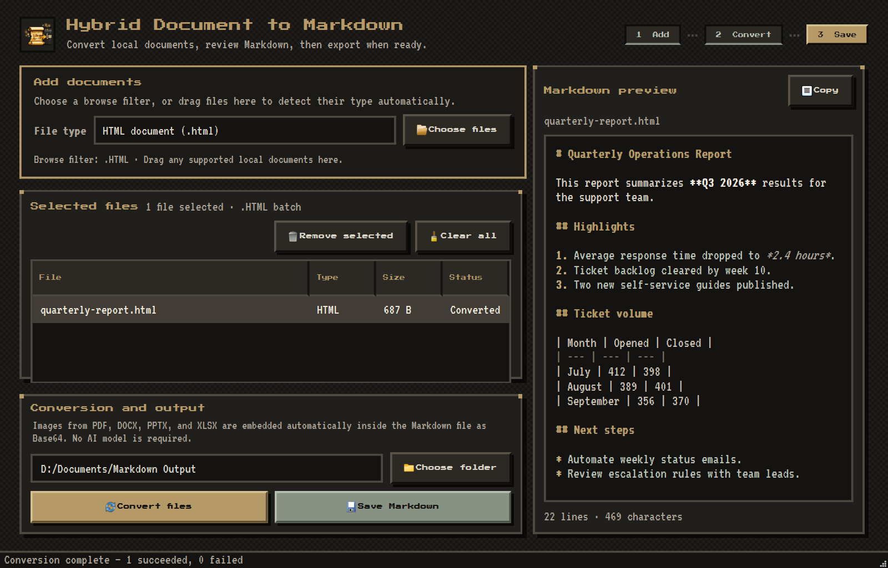
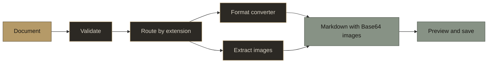

<div align="center">


# Hybrid Document to Markdown

A Windows desktop app that converts local documents into one clean Markdown file, with images kept inside.

[](#-testing)
[](#-quick-start)
[](https://doc.qt.io/qtforpython-6/)
[](#-quick-start)
[](LICENSE)

</div>

<p align="center">
  
</p>

## 🔎 Overview

Hybrid Document to Markdown turns Word, PDF, Office, web, and text files into Markdown that people and LLMs can read. It runs entirely on your computer, with no cloud service, account, or API key. Each document becomes one `.md` file, and its images travel inside that file as Base64.

> [!NOTE]
> This is an independent portfolio project. It uses [Microsoft MarkItDown](https://github.com/microsoft/markitdown) but is not affiliated with Microsoft.

## ✨ Features

- One self-contained `.md` file per document, with images embedded as Base64.
- Headings, numbered lists, tables, footnotes, and Word equations (as LaTeX) carry over when the source defines them.
- Batches of same-type files convert together, and one failed file does not stop the rest.
- A preview shows the Markdown before you copy or save it.
- Each conversion runs in a separate process, so the window stays responsive and a stuck file times out after 120 seconds.

## 🚀 Quick start

You need Windows 10 or 11, Python 3.13, and Git. Dependencies are installed locally and are not stored in this repository.

1. Clone the repository:

   ```powershell
   git clone https://github.com/DrBham/Hybrid-Document-To-Markdown.git
   cd Hybrid-Document-To-Markdown
   ```

2. Create and activate a virtual environment:

   ```powershell
   python -m venv .venv
   .\.venv\Scripts\Activate.ps1
   ```

3. Install the pinned dependencies and check them:

   ```powershell
   python -m pip install -r requirements.txt
   python -m pip check
   ```

   Expected output of the last command:

   ```text
   No broken requirements found.
   ```

4. Start the app:

   ```powershell
   $env:PYTHONPATH = "src"
   python -m document_converter
   ```

   The window from the screenshot above opens.

5. Drop a document onto the window, press **Convert files**, and then **Save Markdown**.

`requirements.txt` pins the tested versions. `requirements.in` lists the direct dependencies.

## 🔬 Try it

This small Word document has a heading, a paragraph, a numbered list, a table, and an equation:

| Word element | Content |
|---|---|
| Heading 1 | Quarterly results |
| Paragraph | Revenue grew in every region. |
| Numbered list | North, South |
| Table | Region / Growth, North / 12% |
| Paragraph with an equation | Growth rate: new over old, as a Word fraction |

The app produces this Markdown:

```markdown
# Quarterly results

Revenue grew in every region.

1. North
2. South

| Region | Growth |
| --- | --- |
| North | 12% |

Growth rate: $\frac{new}{old}$
```

## 🗂️ Supported formats

| Format | Extensions | What carries over | Status |
|---|---|---|:---:|
| Word | `.docx` | Headings, list numbering, tables, equations, footnotes, images | ✅ |
| PDF | `.pdf` | Text layout, ruled tables, images placed in their table cells | ✅ |
| PowerPoint | `.pptx` | Slide text, images, chart data | ✅ |
| Excel | `.xlsx` | Cell values, formulas, images by cell anchor | ✅ |
| Text and data | `.txt`, `.csv`, `.json`, `.xml` | Source text, unchanged | ✅ |
| Web | `.html`, `.htm` | Text, tables, preformatted blocks | ✅ |
| Scanned PDF | `.pdf` (image only) | No OCR, so no text | ❌ |

## 🧭 Usage

1. Add documents with **Choose files** or by dropping them onto the window.
2. Convert them. Each file shows its status in the list.
3. Open a result in the preview.
4. Save the Markdown to the output folder.

> [!TIP]
> A file marked *Converted with warnings* converted fine. Click the warnings chip under the preview to see what is worth a quick check.

**Cancel conversion** stops a running batch and keeps the files that already finished.

<details>
<summary>Use the converter from Python</summary>

```python
from pathlib import Path

from document_converter.core.router import ConverterRouter
from document_converter.services.markdown_exporter import MarkdownExporter

result = ConverterRouter().convert(Path("report.docx"))
MarkdownExporter().export(result.markdown, Path("report.md"), overwrite=False)
```

Use `BatchConverter().convert(paths)` for several files of one type. Encoding, PDF modes, sheet selection, and asset ZIP export are covered in [docs/QUALITY_IMPLEMENTATION.md](docs/QUALITY_IMPLEMENTATION.md#api-and-compatibility).

</details>

## 🔄 How it works

The diagram shows one document's path: validation, a format converter, and image extraction run before the Markdown reaches the preview.



Each format has its own converter. DOCX uses Mammoth plus Word XML parsing, PDF uses pdfplumber geometry, PPTX uses MarkItDown, XLSX uses openpyxl, and the text formats keep their source as is.

<details>
<summary>Project structure</summary>

```text
src/document_converter/
├── converters/      Format-specific converters (DOCX, PDF, Office, HTML, text)
├── core/            Models, options, validation, routing, output contract
├── embedded_media/  Image extraction and Base64 placement
├── services/        Batch runs, worker process, export
└── gui/             PySide6 window, pixel theme and widgets
tests/               Unit, integration, and GUI tests
tools/               Quality probes and the benchmark gate
docs/                Acceptance reports, benchmark results, screenshots
assets/              Logo and bundled pixel fonts (SIL OFL)
```

</details>

## 🧪 Testing

With the virtual environment active:

```powershell
python -m pytest -q
```

Expected last line:

```text
244 passed
```

The benchmark converts a generated corpus in fresh processes and exits non-zero if any check fails:

```powershell
python tools/evaluate_q5.py --repeat 3 --output benchmark-result.json
```

The latest recorded run is in [docs/benchmarks/q6-final-windows.json](docs/benchmarks/q6-final-windows.json).

## ⚠️ Limitations

> [!WARNING]
> Base64 makes a file about one third larger than its original images, and not every Markdown viewer or AI chat displays embedded images.

- Images are kept, not described. There is no OCR.
- A batch accepts one file type at a time, and files over 100 MiB are rejected.
- Encrypted or damaged files may fail to convert.
- No packaged installer exists yet.

## 🗺️ Roadmap

| Milestone | Scope | Status |
|---|---|:---:|
| Conversion core | Ten extensions, desktop app, embedded images | ✅ |
| Quality hardening | Fidelity, reliability, and benchmark gate ([final audit](docs/Q6_FINAL_AUDIT.md)) | ✅ |
| Word fidelity | Equations, list numbering, headings, image alt text | ✅ |
| Windows release | Installer and GitHub release | 🔜 |

See [CHANGELOG.md](CHANGELOG.md) for the full history.

## 📄 License

Project code is released under the [MIT License](LICENSE). Third-party libraries and the bundled fonts keep their own licenses, listed in [THIRD_PARTY_NOTICES.md](THIRD_PARTY_NOTICES.md).
