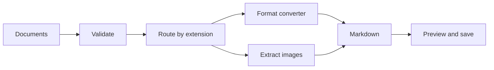

<div align="center">


# Hybrid Document to Markdown

A Windows desktop app that converts local documents into one clean Markdown file, with images kept inside.

[](#testing)
[](#requirements)
[](https://doc.qt.io/qtforpython-6/)
[](#requirements)
[](LICENSE)

</div>

<p align="center">
  
</p>

## Overview

Hybrid Document to Markdown turns everyday documents into Markdown that people and LLMs can read. Everything runs on your computer: no cloud service, account, or API key.

- **One file per document.** Images are embedded as Base64, so the `.md` file is self-contained.
- **Structure is kept.** Headings, numbered lists, tables, equations (as LaTeX), and footnotes carry over where the source defines them.
- **Batch friendly.** Convert several files of the same type at once; one failure does not stop the rest.
- **Review before saving.** Preview the Markdown, copy it, or save it to a folder you choose.

> This is an independent portfolio project. It uses [Microsoft MarkItDown](https://github.com/microsoft/markitdown) but is not affiliated with Microsoft.

## Supported formats

| Format | Extensions | Notes |
|---|---|---|
| Word | `.docx` | Headings, list numbering, tables, equations, footnotes, images |
| PDF | `.pdf` | Text layout, ruled tables, images placed in their table cells |
| PowerPoint | `.pptx` | Slide text, images, chart data |
| Excel | `.xlsx` | Cell values, formulas, images by cell anchor |
| Text and data | `.txt`, `.csv`, `.json`, `.xml` | Source text preserved exactly |
| Web | `.html`, `.htm` | Text, tables, preformatted blocks |

Scanned PDFs are not run through OCR. Complex layouts may still need a quick review.

## Requirements

- Windows 10 or 11
- Python 3.13
- Git

## Installation

Dependencies are not stored in this repository. Install them into a local virtual environment:

```powershell
git clone https://github.com/DrBham/Hybrid-Document-To-Markdown.git
cd Hybrid-Document-To-Markdown

python -m venv .venv
.\.venv\Scripts\Activate.ps1
python -m pip install -r requirements.txt
```

`requirements.txt` pins the tested versions. `requirements.in` lists the direct dependencies.

## Usage

With the virtual environment active, start the app from the repository root:

```powershell
$env:PYTHONPATH = "src"
python -m document_converter
```

1. **Add** documents with *Choose files* or by dropping them onto the window.
2. **Convert** them. Each file shows its status in the list.
3. **Review** a result in the preview. *N warnings* lists anything worth checking; warnings are not errors.
4. **Save** the Markdown to the output folder.

Each file has a 120-second limit, and *Cancel conversion* stops a running batch while keeping finished results.

### Python API

```python
from pathlib import Path

from document_converter.core.router import ConverterRouter
from document_converter.services.markdown_exporter import MarkdownExporter

result = ConverterRouter().convert(Path("report.docx"))
MarkdownExporter().export(result.markdown, Path("report.md"), overwrite=False)
```

Use `BatchConverter().convert(paths)` for several files of one type. Advanced options (encoding, PDF modes, sheet selection, asset ZIP export) are described in [docs/QUALITY_IMPLEMENTATION.md](docs/QUALITY_IMPLEMENTATION.md#api-and-compatibility).

## How it works



Each format has its own converter: Mammoth plus Word XML parsing for DOCX, pdfplumber geometry for PDF, MarkItDown for PPTX, openpyxl for XLSX, and source-preserving paths for text formats. Conversions run in a separate process so the window stays responsive.

## Project structure

```text
src/document_converter/
├── converters/      Format-specific converters (DOCX, PDF, Office, HTML, text)
├── core/            Models, options, validation, routing, output contract
├── embedded_media/  Image extraction and Base64 placement
├── services/        Batch runs, worker process, export
└── gui/             PySide6 window, pixel theme and widgets
tests/               Unit, integration, and GUI tests
tools/               Quality probes and the benchmark gate
docs/                Acceptance reports and benchmark results
assets/              Logo and bundled pixel fonts (SIL OFL)
```

## Testing

```powershell
python -m pytest -q
python tools/evaluate_q5.py --repeat 3 --output benchmark-result.json
```

The suite covers all ten extensions, the GUI workflow, and conversion fidelity. The benchmark converts a generated corpus in fresh processes and exits non-zero if any check fails. The latest recorded run is in [docs/benchmarks/q6-final-windows.json](docs/benchmarks/q6-final-windows.json).

## Limitations

- Base64 makes files about one third larger than the original images, and not every Markdown viewer or AI chat shows embedded images.
- Images are preserved, not described. There is no OCR.
- A batch accepts one file type at a time; files larger than 100 MiB are rejected.
- Encrypted or damaged files may fail to convert.
- A packaged installer is not available yet.

## Roadmap

| Milestone | Scope | Status |
|---|---|---|
| Conversion core | Ten extensions, desktop app, embedded images | Done |
| Quality hardening | Fidelity, reliability, and benchmark gate ([final audit](docs/Q6_FINAL_AUDIT.md)) | Done |
| Word fidelity | Equations, list numbering, headings, image alt text | Done |
| Windows release | Installer and GitHub release | Next |

See [CHANGELOG.md](CHANGELOG.md) for the full history.

## License

Project code is released under the [MIT License](LICENSE). Third-party libraries and the bundled fonts keep their own licenses; see [THIRD_PARTY_NOTICES.md](THIRD_PARTY_NOTICES.md).
